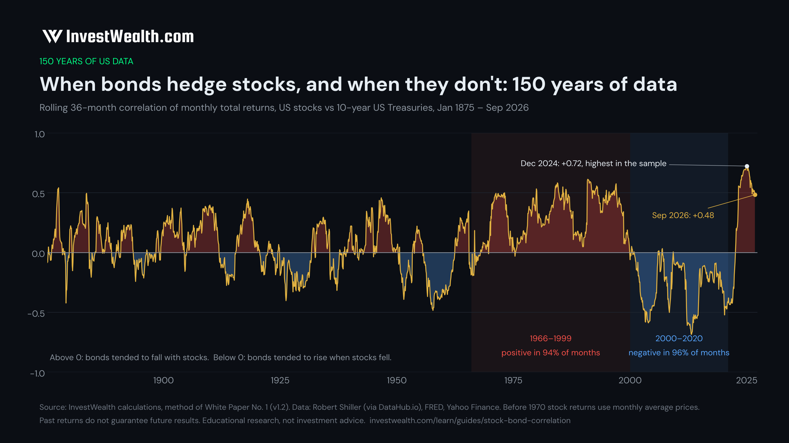

# Stock–bond correlation, 150 years (US, monthly, 1871–2026)

Monthly total returns of US stocks and 10-year US Treasuries from January 1871 to September 2026, the rolling 36-month correlation between them, and a Python script that rebuilds the data and the chart from the public raw sources.



The data are the series behind InvestWealth White Paper No. 1, *When Bonds Stop Hedging* (v1.2, November 2026). The interactive version, with the twelve S&P 500 sell-offs since 1955 and what Treasuries, cash and gold did in each, is the guide **[Stock–bond correlation: when bonds protect stocks, and when they don't](https://www.investwealth.com/learn/guides/stock-bond-correlation?utm_source=github&utm_campaign=gh_02)** on InvestWealth.

## Key facts from the data

Computed by `scripts/correlation.py` from `data/us_stock_bond_monthly_1871_2026.csv` (36-month windows ending January 1875 to September 2026, 1,821 months):

| | |
|---|---|
| Months with a positive correlation since 1875 | **58.6%** (1,067 of 1,821) |
| 1875–1965 | positive in 57.1% of months |
| 1966–1999 | positive in 93.6% of months |
| 2000–2020 | negative in 95.6% of months |
| 2021–Sep 2026 | positive in 73.9% of months |
| Highest reading | **+0.72, December 2024** (highest in the sample) |
| Lowest reading | −0.68, February 2013 |
| Last month in the file | +0.48, September 2026 |

White Paper No. 1 gives these as 58% (58.6% cut to a whole number), 94%, 96%, +0.72 (December 2024) and +0.48 (September 2026). The correlation series here is identical to the paper's (largest difference below 0.00000001).

In plain words: for most of the last 150 years US stocks and Treasuries moved in the same direction more often than not. The 2000–2020 period, when bonds rose in almost every stock sell-off, was the exception.

## Files

| File | What it is |
|---|---|
| `data/us_stock_bond_monthly_1871_2026.csv` | the monthly data (1,869 rows, January 1871 – September 2026) |
| `scripts/correlation.py` | rebuilds the CSV from the raw sources, recomputes the correlation, prints the key facts, draws the chart |
| `charts/correlation_150y.png` | the chart above (3200 × 1800 px) |

### Data columns

| Column | Meaning |
|---|---|
| `month` | calendar month, `YYYY-MM` (returns are for the month ending at its last day) |
| `stock_tr` | US stocks, monthly total return (price change plus dividends), decimal (0.01 = 1%) |
| `bond10_tr` | constant-maturity 10-year US Treasury bond, monthly total return, decimal |
| `yield10` | 10-year yield at the end of the month used to price the bond, decimal |
| `corr36` | correlation of `stock_tr` and `bond10_tr` over the 36 months ending in this month (from January 1874) |
| `stock_source` | which stock series the month comes from (see Method) |
| `yield_source` | which yield series the month comes from (see Method) |

January 1871 has no returns (it is the starting point).

## Method

The method is the one used in White Paper No. 1, unchanged.

**US stocks** (`stock_source`)
- `shiller_monthly_avg`, February 1871 – December 1969: Robert Shiller's S&P Composite series (the S&P 500 and its predecessors). Return = (price + annual dividend / 12) / previous month's price − 1. Shiller's prices are **monthly averages of daily closes**, which smooths returns and lowers measured correlations before 1970.
- `splice_jan1970`, January 1970: S&P 500 close at the end of January 1970 (plus one month of dividend) over Shiller's December 1969 average, so the move from the average to month-end prices is not lost.
- `sp500_month_end_plus_div_yield`, February 1970 – February 1993: S&P 500 month-end close plus 1/12 of Shiller's dividend yield of the previous month.
- `spy_adjusted`, from March 1993: SPY ETF, month-end close adjusted for dividends and splits (a total return after the ETF's costs).

**10-year US Treasuries** (`yield_source`)
- Yields: `shiller_long_rate` (Shiller's long-term interest rate) to March 1953; `fred_gs10` (FRED GS10, monthly average) April 1953 – December 1961; `fred_dgs10_weekly` (FRED DGS10 sampled weekly, ending Friday; last week of each month) from January 1962. Before about 1918 Shiller's long rate is not a Treasury yield.
- Returns: each month a 10-year par bond is bought at last month's yield (semi-annual coupon) and sold a month later at the new yield with 9 years and 11 months left, plus one month of coupon. This is the standard way to turn a yield series into a bond total return when no bond index exists.

**Correlation:** Pearson correlation of the two monthly return series over a rolling 36-month window (pandas `rolling(36).corr`). Above 0: stocks and bonds tended to move in the same direction. Below 0: bonds tended to rise when stocks fell.

## How to reproduce

```bash
pip install pandas numpy matplotlib
python scripts/correlation.py                 # recompute correlation, facts and chart from data/
pip install requests yfinance
python scripts/correlation.py --download      # fetch the raw inputs into raw/ and rebuild data/ from them
```

`--rebuild --raw <folder>` rebuilds from raw files you already have (`shiller_sp500.csv`, `GS10.csv`, `DGS10.csv` from FRED, `GSPC.csv` with `date,close` and `SPY.csv` with `date,adj_close`). Fresh downloads can differ slightly from the published file: data providers revise history, and Yahoo Finance re-adjusts SPY prices for dividends. The published CSV is the exact data of the white paper. For the house fonts, put the DM Sans `.ttf` files in a `fonts/` folder or point `IW_FONTS` to them; otherwise matplotlib's default font is used.

## Sources

- Robert J. Shiller, *U.S. Stock Markets 1871–Present and CAPE Ratio*, the data behind *Irrational Exuberance*: https://shillerdata.com/
- DataHub.io, *Standard and Poor's (S&P) 500 Index Data including Dividend, Earnings and P/E Ratio* (CSV copy of the Shiller data): https://datahub.io/core/s-and-p-500 (raw file: https://github.com/datasets/s-and-p-500)
- Federal Reserve Bank of St. Louis, FRED: 10-Year Treasury Constant Maturity Rate, monthly (GS10) https://fred.stlouisfed.org/series/GS10 and daily (DGS10) https://fred.stlouisfed.org/series/DGS10
- Yahoo Finance: S&P 500 index (^GSPC) https://finance.yahoo.com/quote/%5EGSPC/ and SPDR S&P 500 ETF (SPY) https://finance.yahoo.com/quote/SPY/
- InvestWealth, White Paper No. 1, *When Bonds Stop Hedging*, v1.2 (2026): https://www.investwealth.com/when-bonds-stop-hedging?utm_source=github&utm_campaign=gh_02

## Licence and citation

Data file and chart: CC BY 4.0. Code: MIT. See `LICENSE`. The underlying source data remain subject to their providers' terms.

Suggested citation: Hamann, H. (2026). *Stock–bond correlation, 150 years (US, monthly, 1871–2026)*. InvestWealth. https://github.com/investwealth-com/stock-bond-correlation-150y

Past returns do not guarantee future results. Educational research, not investment advice.

More free data and tools: [InvestWealth guide to the stock–bond correlation](https://www.investwealth.com/learn/guides/stock-bond-correlation?utm_source=github&utm_campaign=gh_02) · [every retirement since 1872](https://github.com/investwealth-com/investwealth-retirement-1872)

Topics: stock-bond-correlation, treasury-bonds, asset-allocation, market-history, economic-data, finance, python, pandas
